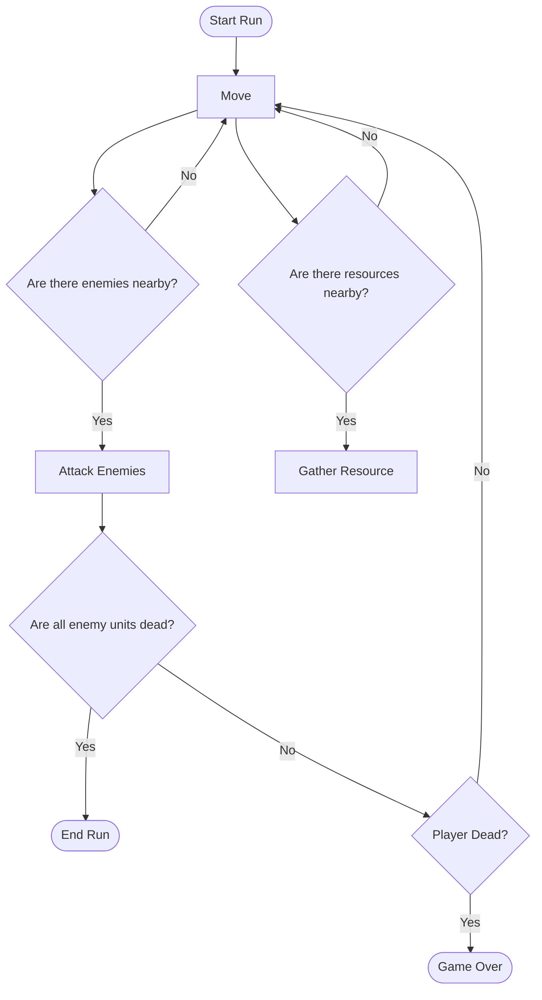

# Table of Contents

- [One Page Game Design Document](#one-page-game-design-document)
  - [Title & Concept](#title--concept)
  - [Genre & Platform](#genre--platform)
  - [Objective](#objective)
  - [Mechanics / Core Loop / Progression](#mechanics--core-loop--progression)
  - [Narrative & Setting](#narrative--setting)
  - [Visual & Audio Style](#visual--audio-style)
  - [Scope & Risks](#scope--risks)
  - [MoSCoW](#moscow)
- [Project Sprint Tracker](#project-sprint-tracker)
  - [Product Backlog](#product-backlog)
  - [Last Sprint](#sprint-1)

# One Page Game Design Document

## Title & Concept
In *Pawny Meadows*, you play as The Pawn, a small adventurer sent by the king of a failing town into a dangerous forest to gather the resources needed to help it grow. The king lends you a small part of his army for protection as you fight through hordes of enemies, expand your forces, and slowly transform your struggling home into the kingdom it deserves to become.

## Genre & Platform
**Genre:** Action roguelite with companion-army and light resource-management elements.
**Platforms:** PC, mobile, and web.

## Objective
The player’s main objective is to help the town grow by exploring deeper into the forest, where greater dangers are matched by more valuable resources.

[comment]: <> (Separei o objetive de progression. Eles costumam ser escritos em conjunto, mas acredito que para ti, será mais fácil pensar no progression junto das mecânicas.)

[comment]: <> (O objetivo também não é super claro. Quando é que eu ganho o jogo?)

[comment]: <> (No Isaac, por exemplo, o jogo considera-se "terminado" quando ganhamos a um dos final bosses. O loop do jogo é construido em torno desse final.)

## Mechanics / Core Loop / Progression
The Pawn gathers resources in the forest by cutting trees for wood, mining gold, and hunting sheep for meat. He acts as the anchor of the army, with allied units staying within a limited range of him, making player positioning important during combat. The Pawn cannot directly damage enemies; combat is handled by the army.

Between runs, the player returns to town to upgrade buildings, improve troop quality, expand the selection of the five starting units, and unlock deeper forest areas as the kingdom grows stronger.

Progression comes from upgrading buildings, which unlock stronger troops, provide more starting-unit choices, and enable the player to reach increasingly dangerous areas of the forest by becoming more powerful.

[comment]: <> (Escreveste pouco sobre as mecânicas de jogo. Estão em falta elementos básicos. Não consigo perceber, por exemplo, quais as mecânicas de batalha. Eu controlo o Pawn, mas não as unidades de batalha? O jogador tem algum dizer nas ações das unidades de batalha? Se for o caso que não controla o exército, quais as ações disponíveis ao jogador? Mover-se? Tens algum jogo de referência para esta mecânica que ajude o leitor a perceber melhor a tua ideia?)

[comment]: <> (O Progression System confunde-me um pouco. Eu posso dar upgrade aos meus buildings que disponibiliza mais troops (different classes). No entanto, no segundo parágrafo, parece que dar upgrade aos buildings é uma ação separa de expandir o teu exército.)

[comment]: <> (Vale a pena escrever o diagrama de fluxo do jogo para quem estiver a ler conseguir perceber melhor o "ritmo" de jogo.)

## Narrative & Setting
The struggling “Kingdom” of **Pawniolis** is, for lack of a better word, not much of a kingdom at all. Its ruler, **King Pawnlon V**, sends his most trusted — and expendable — subject into the surrounding forest to gather the resources needed for the town to grow.

Entrusted with a small group of soldiers, The Pawn must face dangerous forest beasts and critters while helping Pawniolis become the kingdom it so desperately wants to be.

## Visual & Audio Style
*Pawny Meadows* uses the **Tiny Swords** asset pack as its visual foundation, giving the game a cute, chubby and chibi-inspired fantasy style with bright colors and playful proportions.

Its sound design follows the same playful direction, using simple voice-made effects such as “swoosh”, “rah” and subtle spoken footsteps. Characters communicate through short, expressive gibberish inspired by *Animal Crossing*, giving units personality without requiring full voice acting.

## Scope & Risks
*Pawny Meadows* aims to deliver a complete roguelite experience without exceeding the limits of a solo student project. The intended scope includes the Pawn, the companion-army system, resource gathering, randomized forest rooms, enemy encounters, progression through town upgrades, and at least one final boss to provide a complete beginning-to-end experience.

The main risks are the complexity of companion AI, balancing the army around the Pawn, keeping randomized encounters interesting, and preventing the progression systems from expanding beyond the available development time.

These risks will be controlled by keeping troop behavior simple, limiting the number of systems required for the first complete version, and prioritizing a small but fully playable experience over additional content.

## MoSCoW
| Must Have | Should Have | Could Have | Won't Have |
| --- | --- | --- | --- | 
| Moving the Pawn | Five looping rooms | Upgrades/Unlocks
  Units that move and attack | Randomized enemy spawns |
  Minimal HUD with health and unit count | Different types of units (role-based AI) |

# Project Sprint Tracker

## Product Backlog

* AI Path-Finding

---

## Sprint 1

**Semana:** 12-10-2026
**Objetivo:** Os inimigos foca-me na Unit mais próxima e atacam até a unit sair da range our morrer.

| Task | Status |
|------|--------|
| Enemy moves towards the closest Unit. | ⬜ To Do |
| Enemy attacks the closest Unit. | ⬜ To Do |
| Enemy stops when the Unit is out-of-range ou dead. | ⬜ To Do

⬜ To Do · 🟨 In Progress · ✅ Done
