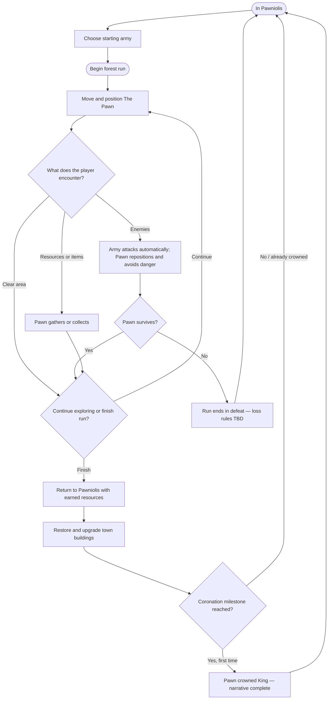

# Table of Contents

- [One Page Game Design Document](#one-page-game-design-document)
  - [Title & Concept](#title--concept)
  - [Genre & Platform](#genre--platform)
  - [Objective](#objective)
  - [Mechanics / Core Loop / Progression](#mechanics--core-loop--progression)
  - [Narrative & Setting](#narrative--setting)
  - [Visual & Audio Style](#visual--audio-style)
  - [Scope & Risks](#scope--risks)
  - [MoSCoW](#moscow)
- [Project Sprint Tracker](#project-sprint-tracker)
  - [Product Backlog](#product-backlog)
  - [Last Sprint](#sprint-1)

# One Page Game Design Document

## Title & Concept

In *Pawny Meadows*, you play as **The Pawn**, a small adventurer sent by the king of a struggling town into a dangerous forest to gather resources and help the settlement grow. The king lends The Pawn a handful of soldiers for protection. By surviving expeditions, leading a companion army, and rebuilding the town, The Pawn gradually transforms Pawniolis into a thriving kingdom.

## Genre & Platform

**Genre:** Action roguelite with a companion-army system and light resource management.  
**Target platforms:** PC, mobile, and web (platform support and controls to be validated during development).

## Objective & Victory Conditions

The player explores the forest to gather resources, improve their army, and develop **Pawniolis**.

**Narrative victory:** As the town grows, its inhabitants realize that The Pawn—not King Pawnlon V—is responsible for its recovery. At a major town-development milestone (provisionally around **50–75%** of total town progression), the townspeople overthrow the old king and crown The Pawn the new ruler. The Pawn gains a small crown as a permanent visual reward. **The coronation completes the main narrative; it is triggered by town progression, not by defeating a final boss.** The exact upgrade threshold is *TBD*.

**Full progression:** Play continues after the coronation. The player can keep upgrading Pawniolis until the town reaches its maximum development and all planned classes and upgrades are unlocked. After that, forest runs remain available as open-ended endgame play.

A final forest boss is a potential capstone encounter for the complete game, **not** the trigger for the coronation. Its role and implementation scope still need to be finalized.

## Mechanics / Core Loop / Progression

### Player Actions & Combat

- The player **directly controls The Pawn's movement**. The Pawn does **not** attack or deal direct damage.
- Allied soldiers **move and fight automatically**. The player does not issue individual attack commands in the current design.
- The Pawn is the army's **anchor**: troops follow and stay within a limited range. The player's movement indirectly affects where the army positions and fights.
- Most enemies engage the army. Certain **Pawn-hunting enemies** ignore soldiers and pursue The Pawn directly, so the player cannot simply hide behind the army.
- Some enemy attacks display **visible danger zones** (for example, red areas on the ground). The player survives by **walking out of danger** before the attack occurs. There is **no dedicated dash, dodge roll, or invincibility dodge mechanic** planned.
- Between encounters, The Pawn **cuts trees for wood, mines gold, hunts sheep for meat, and collects items** found during runs. The details of item effects are *TBD*.

### Town & Army Progression

Resources gathered during runs are spent in Pawniolis between expeditions:

| Building | Purpose |
| --- | --- |
| **Main Castle** | Governs town progression and caps the upgrade level of other buildings. For example, Castle Level 2 is required before another building can reach Level 2. |
| **Troop-class buildings** | Each troop class has a dedicated building. Rebuilding a ruined one unlocks that class; upgrading it strengthens that class. |
| **Houses** | Building or upgrading houses increases the maximum number of soldiers the player can bring into a run. |

The player starts with a **small army of approximately two or three Knights**. Other troop classes must be unlocked through their buildings. **Before each run**, the player freely chooses a mix of unlocked troop classes, up to the available army capacity.

**No mid-run recruitment** is planned for the first version; it may be reconsidered later. The maximum army size, precise upgrade costs, building quantities, and troop statistics are *TBD* and will be balanced through playtesting. Other building artwork in the asset pack may be used to help the town feel complete, but it does **not** automatically imply additional systems such as town-defense battles.

### Run Structure

1. **Prepare in Pawniolis:** choose a starting army from unlocked classes within the current capacity.
2. **Enter the forest:** move through encounters and resource areas, positioning the army while avoiding attacks that threaten The Pawn.
3. **Fight and gather:** automated troops fight; The Pawn survives, chops trees, mines gold, hunts sheep, and picks up items.
4. **Finish the expedition:** return to town with the resources earned on a successful run; the exact rules for leaving a run and what happens to collected resources on defeat remain *TBD*.
5. **Develop Pawniolis:** restore buildings, upgrade troops, and expand army capacity, then prepare for another run.

The intended larger game includes **randomized forest rooms and increasingly dangerous areas**. The exact room count and how an expedition ends are still being designed.

### Gameplay Flow (Design-Level)

*Note: This is a design overview rather than a finalized room-by-room state machine. In particular, run-exit and defeat-resource rules are undecided.*

## Narrative & Setting

The struggling “Kingdom” of **Pawniolis** is, for lack of a better word, not much of a kingdom at all. Its ruler, **King Pawnlon V**, sends his most trusted—and expendable—subject into the surrounding forest to gather the resources needed for the town to grow.

Entrusted with a small group of soldiers, The Pawn faces dangerous forest beasts and critters while helping Pawniolis become the kingdom it wants to be. As the settlement prospers, its citizens recognize The Pawn's efforts and eventually choose The Pawn as their new ruler.

## Visual & Audio Style

*Pawny Meadows* uses the **Tiny Swords** asset pack as its visual foundation: cute, chubby, chibi-inspired fantasy characters, bright colors, and playful proportions.

Audio follows the same lighthearted direction, with simple voice-made effects such as “swoosh,” “rah,” and subtle spoken footsteps. Characters communicate through short expressive gibberish inspired by *Animal Crossing*, rather than full voice acting.

## Scope & Risks

The **long-term goal** is a small but complete roguelite with companion combat, resource gathering, a growing town, randomized forest encounters, meaningful progression, post-coronation replayability, and potentially a final boss.

The **first playable MVP** is intentionally narrower: establish that controlling The Pawn while an automatic companion army fights enemies is enjoyable and technically reliable. Town rebuilding, the full resource economy, and the coronation are **not requirements for the initial combat MVP**.

**Primary risks:** companion navigation and AI, readability of telegraphed enemy attacks, balancing player safety against indirect army control, room variety, and feature creep. The response is to prototype core combat first, test a small set of units/enemies, and expand only after the movement and combat loop feels good.

## MoSCoW — First Playable Combat MVP

| Must Have | Should Have | Could Have | Won't Have (in this MVP) |
| --- | --- | --- | --- |
| Pawn movement and health/death | A short multi-room encounter sequence (target: five rooms) | More than one enemy behavior | Full town progression and building upgrades |
| Small automatic army that follows and attacks | Randomized enemy spawns | Early resource-gathering interaction | Coronation and narrative ending |
| At least one enemy that fights the army | Pawn-targeting enemy and readable danger-zone attack | Additional troop roles and simple effects | Complete forest biome, all troop classes, and full endgame |
| Basic encounter completion/restart | Minimal HUD (health and unit count) | Basic sound feedback | Mid-run troop recruitment |

*MoSCoW applies only to the **initial combat MVP**, not to every feature promised for the eventual complete game. Priorities may be adjusted after teacher feedback and testing.*

# Project Sprint Tracker

## Product Backlog

* AI Path-Finding

---

## Sprint 1

**Week:** 12-10-2026
**Objective:** Making enemies walk towards and attack the closest target until the target either leaves the enemy's range or dies.

| Task | Status |
|------|--------|
| Enemy moves towards the closest Unit. | ⬜ To Do |
| Enemy attacks the closest Unit. | ⬜ To Do |
| Enemy stops when the Unit is out-of-range or is dead. | ⬜ To Do

⬜ To Do · 🟨 In Progress · ✅ Done
