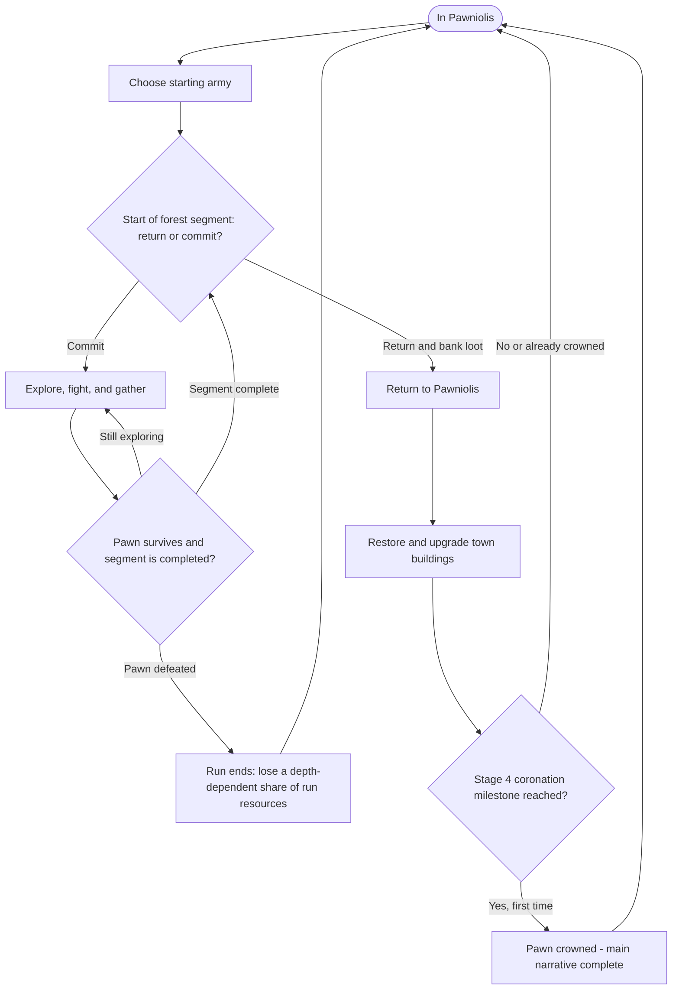

## Table of Contents

- [Title & Concept](#title--concept)
- [Genre & Platform](#genre--platform)
- [Objective & Victory Conditions](#objective--victory-conditions)
- [Mechanics / Core Loop / Progression](#mechanics--core-loop--progression)
  - [Player Actions & Combat](#player-actions--combat)
  - [Town & Army Progression](#town--army-progression)
  - [Royal Formation](#royal-formation)
  - [Run Structure](#run-structure)
  - [Gameplay Flow (Design-Level)](#gameplay-flow-design-level)
- [Narrative & Setting](#narrative--setting)
- [Visual & Audio Style](#visual--audio-style)
- [Scope & Risks](#scope--risks)
- [MoSCoW — First Playable Combat MVP](#moscow--first-playable-combat-mvp)
- [Open Design Questions](#open-design-questions)
- [Project Sprint Tracker](#project-sprint-tracker)

# One Page Game Design Document

## Title & Concept

In *Pawny Meadows*, you play as **The Pawn**, a small adventurer sent by the king of a struggling town into a dangerous forest to gather resources and help the settlement grow. The king lends The Pawn a handful of soldiers for protection. By surviving expeditions, leading a companion army, and rebuilding the town, The Pawn gradually transforms Pawniolis into a thriving kingdom.

## Genre & Platform

**Genre:** Action roguelite with a companion-army system and light resource management.  
**Engine:** Godot 4 / GDScript.  
**Target platforms:** PC, mobile, and web (platform support and controls to be validated during development).

## Objective & Victory Conditions

The player explores the forest to gather resources, improve their army, and develop **Pawniolis**.

**Narrative victory:** As the town grows, its inhabitants realize that The Pawn—not King Pawnlon V—is responsible for its recovery. At **Town Stage 4 (Gold)**, the townspeople overthrow the old king and crown The Pawn the new ruler. The Pawn gains a small crown as a visual reward. **The coronation completes the main narrative and is triggered by town progression, not a boss fight.**

**Town progression:** Pawniolis has **six states**, starting at **Stage 0 (Ruins)** and advancing through five themed upgrades: **Stage 1 Blue → Stage 2 Red → Stage 3 Purple → Stage 4 Gold → Stage 5 Black**. Stage 0 shares the Blue troop recolor with Stage 1.

**After the ending:** Stage 5 (Black) is optional postgame maximum progression with a **secret final boss**. Neither Stage 5 nor the boss is required to finish the main story. The precise encounter, unlock conditions, and implementation schedule remain open. Forest runs may continue after the coronation.

## Mechanics / Core Loop / Progression

### Player Actions & Combat

- The player **directly controls The Pawn's movement**. The Pawn does **not** attack or deal direct damage.
- Allied soldiers **move and fight automatically**. The player does not issue individual attack commands in the initial design. A player-directed targeting system may be considered in future updates.
- The Pawn is the army's **anchor**: troops follow a Pawn-relative formation and can engage nearby enemies only within a limited **leash distance** from The Pawn. Exact engagement and leash ranges are not finalized.
- Each soldier is intended to select the **nearest valid enemy to that soldier** and retain the target until it becomes invalid, rather than constantly switching targets.
- Certain **Pawn-hunting enemies** ignore soldiers and pursue The Pawn directly, so the player cannot simply hide behind the army.
- Some enemy attacks display **visible danger zones** (for example, red areas on the ground). The player survives by **walking out of danger** before the attack occurs. There is **no dedicated dash, dodge roll, or invincibility dodge mechanic** planned.
- The Pawn has health; **Pawn defeat ends the expedition**. An allied soldier reduced to zero health **retreats for the rest of that run**, but is available again for future expeditions.
- The Pawn—not the soldiers—**gathers resources**. Planned activities include chopping trees for wood, mining, collecting dropped resources/items, and potentially hunting sheep for meat. Exact gathering interactions and item effects are *TBD*.

### Town & Army Progression

Resources gathered during runs are spent in Pawniolis between expeditions:

| Building | Purpose |
| --- | --- |
| **Main Castle** | Governs overall town progression and caps the upgrade level of other buildings. For example, Castle Level 2 is required before another building can reach Level 2. |
| **Troop-class buildings** | Each troop class has a dedicated building. Rebuilding a ruined one unlocks that class; upgrading it strengthens that class. |
| **Houses** | Building or upgrading houses increases army capacity, up to the limit allowed by the current Main Castle stage. Advancing the Castle raises that limit but does not automatically upgrade Houses or add soldiers. |

**Town stages:**

| Stage | Theme | Progression meaning |
| --- | --- | --- |
| **0** | Ruins / Blue troop palette | Introductory resource runs help restore the ruined settlement. |
| **1** | Blue | First restoration of Pawniolis. |
| **2** | Red | Growth and new development opportunities. |
| **3** | Purple | Prosperity and recognition of The Pawn's contributions. |
| **4** | Gold | **Coronation — main narrative ending.** |
| **5** | Black | **Optional postgame** maximum development and secret final boss. |

The player begins with approximately **two or three Warriors** (starting troop count is provisional), with an intended starting **capacity of three soldiers**. Other troop classes unlock through their buildings. **Before each run**, the player chooses any mix of unlocked classes within the available army capacity.

Classes discussed so far include **Warrior**, **Archer**, **Lancer**, and **Monk**. **No mid-run recruitment** is planned for the first full version. Building quantities, upgrade costs, troop statistics, and how independent troop upgrades affect recolors remain *TBD*. Other artwork in the asset pack may make the town feel complete but does **not** automatically imply extra systems such as town-defense battles.

### Royal Formation

**Decided design.** The Pawn leads a compact, rotating formation with a maximum of **11 troop slots**. **Houses determine the capacity actually unlocked**, while the **Main Castle stage caps how far Houses can be upgraded**. The maximum capacity permitted at each town stage is **3 (Stage 1 / Blue) → 5 (Stage 2 / Red) → 7 (Stage 3 / Purple) → 9 (Stage 4 / Gold) → 11 (Stage 5 / Black)**. Reaching a new stage raises the ceiling; it does **not** automatically grant those extra slots. The ruined Stage 0 starts with the provisional three-slot capacity.

| Capacity | Available formation slots |
| --- | --- |
| **3** | 01 (vanguard), 06 and 07 (Pawn guards) |
| **5** | Previous + 09 and 10 (inner backline) |
| **7** | Previous + 02 and 03 (front shoulders) |
| **9** | Previous + 04 and 05 (outer flanks) |
| **11** | Previous + 08 and 11 (outer backline) |

Slot roles describe **preferred positioning, not fixed class restrictions**. The player may place any unlocked troop class in an available slot. An unoccupied unlocked slot is allowed. The planned implementation will assign unique slots when assembling the army, then let troops follow their Pawn-relative offsets; exact offsets, pathfinding, and mid-run regrouping remain open.

### Run Structure

**The following describes the planned complete game, not the current combat prototype.**

1. **Prepare in Pawniolis:** choose a starting army from unlocked classes within the current House-derived capacity.
2. **Reach a forest segment decision:** at the **start of every segment**, either **return to town and bank the resources collected so far** or **commit to the next segment**.
3. **Commit and explore:** once committed, the player **cannot voluntarily leave until the segment is complete**. Automated troops fight while The Pawn positions them indirectly, avoids danger, and gathers resources.
4. **Complete a segment or lose the run:** successful completion leads to the next return-or-commit decision. If The Pawn is defeated, the run ends and the player loses a **depth-dependent portion of that run's resources, approximately 0–50%**; exact values and calculations remain *TBD*.
5. **Develop Pawniolis:** spend successfully banked resources to restore buildings, improve troops, and expand army capacity before the next expedition.

Deeper forest segments are intended to increase both potential rewards and risk. Forest rooms and encounters may be randomized, but the exact number of rooms per segment, segment-completion rules, and resource-loss formula are still being designed.

### Gameplay Flow (Design-Level)

*Note: This is a design overview rather than a finalized room-by-room state machine. The voluntary return decision is available at segment boundaries, not during a committed segment. Detailed defeat losses and segment structure remain open.*

## Narrative & Setting

The struggling “Kingdom” of **Pawniolis** is, for lack of a better word, not much of a kingdom at all. Its ruler, **King Pawnlon V**, sends his most trusted—and expendable—subject into the surrounding forest to gather the resources needed for the town to grow.

Entrusted with a small group of soldiers, The Pawn faces dangerous forest beasts and critters while helping Pawniolis become the kingdom it wants to be. As the settlement prospers, its citizens recognize The Pawn's efforts and eventually choose The Pawn as their new ruler.

## Visual & Audio Style

*Pawny Meadows* uses Pixel Frog's **Tiny Swords** asset pack as its visual foundation: cute, chubby, chibi-inspired fantasy characters, bright colors, and playful proportions.

Audio follows the same lighthearted direction, with simple voice-made effects such as “swoosh,” “rah,” and subtle spoken footsteps. Characters communicate through short expressive gibberish inspired by *Animal Crossing*, rather than full voice acting.

## Scope & Risks

The **long-term goal** is a small but complete roguelite with companion combat, resource gathering, a growing town, varied forest encounters, meaningful progression, and post-coronation replayability. The **main story ends at Stage 4**, and the Stage 5 secret boss is **optional postgame content**, not a mandatory requirement for that ending.

Development is divided into distinct milestones:

1. **Prototype (current):** Validate the Pawn, Warrior, Archer, and enemy together in `TestingHub`, with real damage and retreat/defeat outcomes, functional combat behavior, obstacle-aware navigation, tree collisions, and correct Y-sorting.
2. **First playable combat MVP (next):** Turn the prototype into a small playable exploration/combat loop with room progression. Full town-building, forest economy, and coronation are **not** requirements for this MVP.
3. **First Full Version:** Implement forest expeditions, resource gathering, army selection, town upgrades, and the **Stage 4 coronation**.
4. **Optional postgame:** Complete **Stage 5 (Black)** and the secret final boss; exact scope and mechanics remain open.

**Primary risks:** companion navigation and AI, readability of telegraphed enemy attacks, balancing player safety against indirect army control, room variety, and feature creep. The response is to prototype core combat first, test a small set of units/enemies, and expand only after movement and combat feel reliable.

## MoSCoW — First Playable Combat MVP

| Must Have | Should Have | Could Have | Won't Have (in this MVP) |
| --- | --- | --- | --- |
| Pawn movement and health/death | A short multi-room encounter sequence (target: five rooms) | More than one enemy behavior | Full town progression and building upgrades |
| Small automatic army that follows and attacks | Randomized enemy spawns | Early resource-gathering interaction | Coronation and narrative ending |
| At least one enemy that fights the army | Pawn-targeting enemy and readable danger-zone attack | Additional troop roles and simple effects | Complete forest biome, all troop classes, and full endgame |
| Basic encounter completion/restart | Minimal HUD (health and unit count) | Basic sound feedback | Mid-run troop recruitment |

*MoSCoW applies only to the **initial combat MVP**, not to every feature promised for the eventual complete game. Priorities may be adjusted after teacher feedback and testing. The five-room sequence is a suggested target, not a locked room count.*

## Open Design Questions

- Exact room/segment counts, segment-completion conditions, and randomized encounter structure.
- Precise combat stats, enemy detection/attack ranges, ally engagement/leash distances, and target reacquisition details.
- Building quantities, upgrade costs, resources, balance, and how Houses unlock each capacity tier.
- Final troop roster, individual class improvements, and the army selection interface.
- Troop recolors when class-building upgrades and overall town stages differ.
- Exact defeat-loss formula within the proposed 0–50% range, loot banking details, and resource-gathering interactions.
- Final implementation of formation slot coordinates, obstacle avoidance, and regrouping after a soldier retreats.
- Stage 5 boss identity, encounter/unlock rules, and optional-postgame delivery scope.
- Final platform controls, export support, and validation for PC, web, and mobile.

**Teacher-authored sprint note:** Mari’s original sprint objective and task wording are preserved. Statuses reflect the developer’s current classroom-prototype assessment and remain subject to Mari’s review. At present, the enemy pursues the first ally entering its detection area (not necessarily the closest), and its attack is visual only; timed damage and death handling remain to be implemented.

# Project Sprint Tracker

## Product Backlog

* AI Path-Finding

---

## Sprint 1

**Week:** 12-10-2026
**Objective:** Making enemies walk towards and attack the closest target until the target either leaves the enemy's range or dies.

| Task | Status |
|------|--------|
| Enemy moves towards the closest Unit. | ✅ Done |
| Enemy attacks the closest Unit. | ✅ Done |
| Enemy stops when the Unit is out-of-range or is dead. | ✅ Done |

⬜ To Do · 🟨 In Progress · ✅ Done
